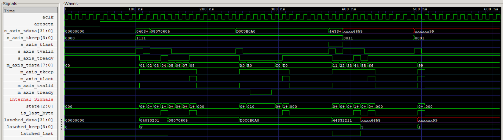

# AXI4-Stream Data Width Adapter (Verilog)

Verilog HDL implementation of an AXI4-Stream data width adapter that converts 32-bit input data
into 8-bit output transfers while maintaining the AXI4-Stream handshake protocol, data integrity,
and control signal synchronization.

---

## 📌 Overview

In many SoC and FPGA designs, two blocks on an AXI4-Stream link use different data widths. A wide
producer (32-bit) may need to feed a narrow consumer (8-bit). This adapter sits between them: it
accepts one 32-bit word, then sends it out as a sequence of 8-bit beats, and only accepts the next
word when the current one has been fully sent.

```
 Upstream (32-bit)                         Downstream (8-bit)
 ┌──────────────┐   s_axis (32b)   ┌───────────────┐   m_axis (8b)   ┌──────────────┐
 │  Source      │ ───────────────► │ Width Adapter │ ──────────────► │  Sink        │
 │              │ ◄─────────────── │  32 → 8       │ ◄────────────── │              │
 └──────────────┘   TVALID/TREADY └───────────────┘  TVALID/TREADY  └──────────────┘
```

## ✨ Key Features

- **32-bit to 8-bit width conversion** (one input word becomes four output bytes).
- **AXI4-Stream VALID/READY handshake** on both the input and output sides.
- **Data integrity:** no byte is dropped or duplicated when the downstream side applies backpressure.
- **Control signal synchronization** (such as `TLAST`) aligned with the final output byte of a word/packet.
- **Self-contained testbench** with a generated waveform dump and a waveform screenshot.

## 🗂️ Repository Structure

| File | Description |
|------|-------------|
| `axi4_stream_adapter.v` | RTL for the 32-bit to 8-bit AXI4-Stream adapter |
| `tb.v` | Testbench that drives input words and checks the output byte stream |
| `dump.vcd` | Waveform dump generated by the simulation |
| `waveform.png` | Screenshot of the simulation waveform |

## ⚙️ How It Works

1. **Accept:** when the input `TVALID` is high and the adapter is ready, it captures the 32-bit word
   and deasserts its input `TREADY` so no new word is taken mid-conversion.
2. **Serialize:** the captured word is sent out one byte at a time on the 8-bit output, with output
   `TVALID` high for each byte.
3. **Backpressure:** if the downstream block holds `TREADY` low, the adapter holds the current byte
   and does not advance, so no data is lost.
4. **Finish:** after the fourth byte is accepted, the adapter becomes ready for the next 32-bit word.
   `TLAST` (if used) is asserted on the last byte of the final word.

## 🧪 Simulation

**Icarus Verilog + GTKWave**

```bash
iverilog -o adapter_sim axi4_stream_adapter.v tb.v
vvp adapter_sim
gtkwave dump.vcd
```

**Xilinx Vivado**

1. Create an RTL project and add `axi4_stream_adapter.v` as a design source.
2. Add `tb.v` as a simulation source and set it as the simulation top.
3. Run **Simulation → Run Behavioral Simulation**.

**What to look for in the waveform**

- Each 32-bit input word produces four consecutive 8-bit output beats.
- Output data holds steady while the downstream `TREADY` is low.
- Input `TREADY` stays low while a word is still being sent out.



## 🛠️ Tools

- Verilog HDL
- Simulation: Vivado

## 🚧 Possible Future Work

- Parameterize the input and output widths (for example `IN_WIDTH` and `OUT_WIDTH`).
- Support `TKEEP` / `TSTRB` for partial final words.
- Add the reverse adapter (8-bit to 32-bit).
- Convert the testbench to a self-checking one with automatic pass/fail output.
